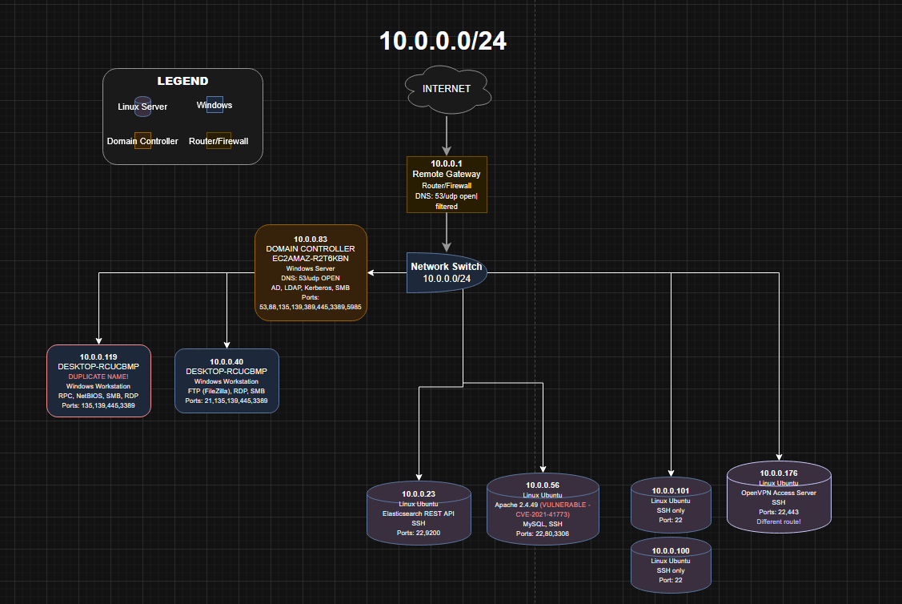

  

# ICC-003 — Purple Team Security Exercise

A team Purple Team exercise on an Active Directory lab (`10.0.0.0/24`): Red Team runs a black-box attack, then Blue Team analyses the telemetry to find what was detected and what was not.

**Team:** The Bugs · **Environment:** CyberCore · corp.org · AWS-hosted
**Status:** Both phases complete. Result: full Active Directory domain compromise, overall risk CRITICAL.

## Contents

- [Principles](#principles)
- [Lab environment](#lab-environment)
- [Method](#method)
- [Findings](#findings)
- [How the repository is organised](#how-the-repository-is-organised)
- [Limits of this exercise](#limits-of-this-exercise)
- [Responsible use](#responsible-use)

## Principles

- Scope is `10.0.0.0/24`. Initial access is `10.0.0.219`, with credentials provided separately.
- Out of scope, never to be targeted: `10.0.0.23`, `10.0.0.100`, `10.0.0.200`, `10.0.0.176`.
- Prohibited: DoS, RDP brute-force, attacks on the hypervisor or cloud control plane, attacks on OpenVPN or security tooling, changes to firewall or port configuration, OS or software updates, deleting or corrupting data, and disrupting availability.
- Reboots are reported to White Team. All activity follows the AWS Penetration Testing Policy.
- Red Team documents failures as well as successes.
- Blue Team states its visibility gaps explicitly, with log sources and queries.

## Lab environment

In-scope hosts named in the exercise documents (from [RTO1](red-team/objectives/RTO1_network-enumeration.md)):

| Host | OS | Key services |
|------|----|--------------|
| `10.0.0.40` | Windows Server | FTP (21), SMB (445), RDP (3389) |
| `10.0.0.119` (DESKTOP-RCUCBMP) | Windows 10 | RDP (3389), SMB (445) |
| `10.0.0.219` (IP-10-0-0-219) | Linux | SSH (22), HTTP (80) |
| EC2AMAZ-R2T6KBN (domain controller, corp.org) | Windows Server | LDAP (389), SMB (445), RDP (3389) |

The exercise has 9 in-scope hosts in total. The full attack path, step by step with MITRE ATT&CK techniques, is in [purple-team/attack-path-summary.md](purple-team/attack-path-summary.md).

## Method

| Field | Value |
|-------|-------|
| **Type** | Purple Team (Red executes, then Blue analyses) |
| **Scope** | `10.0.0.0/24` |
| **Initial access** | `10.0.0.219` (credentials provided separately) |

### Phase 1: Red Team ([red-team/](red-team/))

Objectives:

1. Network enumeration and topology diagram ([RTO1](red-team/objectives/RTO1_network-enumeration.md))
2. Vulnerability discovery (at least one web app) with CWE and CVSS ([RTO2](red-team/objectives/RTO2_vulnerability-discovery.md))
3. At least one custom Python tool, documented in the repo ([RTO3](red-team/objectives/RTO3_custom-tooling.md), [pentest_scanner.py](red-team/tools/pentest_scanner.py))
4. Exploitation, lateral movement and privilege escalation, with failures documented ([RTO4](red-team/objectives/RTO4_exploitation.md))

Outcomes:

- 6 of 9 in-scope hosts affected.
- 2 critical, 2 high and 3 medium vulnerabilities found.
- Domain Administrator reached through FTP credential theft, RDP, an LSASS dump and an offline hash crack.
- Independent remote code execution through Apache CVE-2021-41773 (CVSS 9.8).

### Phase 2: Blue Team ([blue-team/](blue-team/))

Objectives: analyse the Phase 1 telemetry, map it to MITRE ATT&CK, document what was visible and what was blind (with log sources and queries), and explain the gaps. All five Blue Team objectives (BTO1 to BTO5) are marked complete.

Outcomes:

- 4 Windows events detected: `1102`, `4625`, `4624`, `1149`.
- FTP credential exfiltration and the Apache RCE captured in PCAP.
- An interactive IR dashboard: [blue-team/dashboard/](blue-team/dashboard/).

### Purple synthesis ([purple-team/](purple-team/))

Combines both phases into one kill chain, detection coverage, critical findings and prioritised remediation.

## Findings

| Finding | Detection | Source |
|---------|-----------|--------|
| Anonymous FTP on `10.0.0.40` exposes a file used to get RDP access (root cause of the main chain) | Logged; no alert configured | [purple-team/README.md](purple-team/README.md) |
| RDP login to `10.0.0.119` using the obtained credentials | Detected (Event 1149) | [attack-path-summary.md](purple-team/attack-path-summary.md) |
| LSASS dump on `10.0.0.119` | Not detected: no Sysmon or EDR | [mitre-attack-mapping.md](blue-team/mitre-attack-mapping.md) |
| Offline hash cracking | Not detected: offline activity | [mitre-attack-mapping.md](blue-team/mitre-attack-mapping.md) |
| SMB lateral movement | Detected (Events 4624, 4625, PCAP) | [mitre-attack-mapping.md](blue-team/mitre-attack-mapping.md) |
| Domain Administrator access | Not confirmed: log cleared | [attack-path-summary.md](purple-team/attack-path-summary.md) |
| Security log cleared on the domain controller (24,362 events) | Detected (Event 1102) | [mitre-attack-mapping.md](blue-team/mitre-attack-mapping.md) |
| Apache 2.4.49 CVE-2021-41773 RCE on `10.0.0.219` (independent path) | Detected in PCAP | [attack-path-summary.md](purple-team/attack-path-summary.md) |

Coverage, by three different measures in the documents:

- Techniques: 6 of 14 detected (43%) ([mitre-attack-mapping.md](blue-team/mitre-attack-mapping.md)).
- Kill-chain steps: 6 of 9 detected, but the most critical step (LSASS dump to Domain Admin) was invisible ([attack-path-summary.md](purple-team/attack-path-summary.md)).
- Attack phases: 4 of 6 produced detectable telemetry ([blue-team/README.md](blue-team/README.md)).

Priority 1 remediation: disable anonymous FTP and remove credentials from FTP-accessible directories, deploy Sysmon on all Windows hosts, patch Apache, and alert in real time on Event 1102. The full list (P1 to P3) is in [purple-team/README.md](purple-team/README.md).

## How the repository is organised

| Path | Contents |
|------|----------|
| [red-team/](red-team/) | Phase 1. [objectives/](red-team/objectives/) (RTO1 to RTO4), [tools/](red-team/tools/) (`pentest_scanner.py`, which wraps Nmap, WhatWeb and SQLMap and writes a text report), [evidence/](red-team/evidence/) (screenshots, raw scan outputs, `dc_poc.mp4`). Tools used: Nmap, WhatWeb, SQLMap, LinPEAS and the custom scanner. |
| [blue-team/](blue-team/) | Phase 2. [detections/](blue-team/detections/) (Windows events, FTP session 1110, PCAP analysis), [mitre-attack-mapping.md](blue-team/mitre-attack-mapping.md), [dashboard/](blue-team/dashboard/) (IR dashboard, open `index.html` in a browser), [evidence/](blue-team/evidence/). |
| [purple-team/](purple-team/) | Synthesis: [README.md](purple-team/README.md) (coverage, visible vs. blind activity, remediation), [attack-path-summary.md](purple-team/attack-path-summary.md) (kill chain with MITRE IDs) and [diagrams/](purple-team/diagrams/). |
| [docs/](docs/) | The assignment brief ([ICC-03_PurpleTeam_Assignment.pdf](docs/ICC-03_PurpleTeam_Assignment.pdf)) and the banner. |
| [scripts/](scripts/) | `Blackboxtool.py`, a Python enumeration tool (service detection, LDAP, SMB, Kerberos, BloodHound, Nmap, WhatWeb, Nikto, Gobuster, WAFW00F and Elasticsearch checks, with an HTML report), and `checkfiles`, a short shell snippet that searches a host for configuration files. |

## Limits of this exercise

- No Sysmon or EDR on the Windows hosts: the LSASS dump and command execution left no detectable events.
- No NIDS: Nmap and WhatWeb reconnaissance was not flagged.
- Offline hash cracking cannot be seen in logs.
- The Security log on the domain controller was cleared (Event 1102), so Domain Administrator activity could not be confirmed.
- Anonymous FTP activity was logged, but no alert fired; it was found only in post-incident review of the FTP logs and PCAP.
- Detection coverage is reported in three ways (techniques, kill-chain steps, attack phases), so the percentages cannot be compared directly.

## Responsible use

Everything here was done in an authorised lab, inside the scope and rules above. Do not use these techniques or tools against systems you do not own or have written permission to test.
